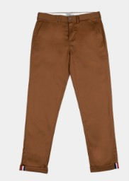
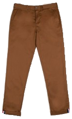

# Garment Instance Segmentation

Garment segmentation with YOLOv8, local image post-processing, and training/comparison pipelines for YOLOv8n-seg, YOLO11n-seg and Mask R-CNN on a 24-class Fashionpedia subset.

## Local inference

Use Python 3.10+ in a virtual environment:

```bash
python -m pip install -r requirements.txt
python main.py
python main.py input output
```

The default input contains the supplied `pants2.jpg` example. Default input, output and model paths are resolved relative to `main.py`; explicitly supplied input/output paths are relative to the working directory. The included checkpoint is loaded from `models/yolov8n_seg_best.pt`.

For each detected garment the application saves a transparent PNG crop, a cropped mask PNG and JSON metadata containing the category, confidence, original bounding box, crop bounding box and polygon coordinates. `mask_polygon` is a simplified convex hull in original-image coordinates, not the exact mask boundary. `crop_bbox` uses `[x, y, width, height]`; `bbox` uses `[x1, y1, x2, y2]`.

## Repository layout

```text
main.py                   Folder inference entry point
segmentation.py           Model loading and image post-processing
requirements.txt          Inference dependencies
input/pants2.jpg          Supplied example image
models/                   Original YOLOv8 checkpoint and checksum
training/                 Four cleaned training/comparison pipelines
```

## Included inference example

A local test with the supplied checkpoint processed `input/pants2.jpg` and produced the files in `examples/pants2/`.



